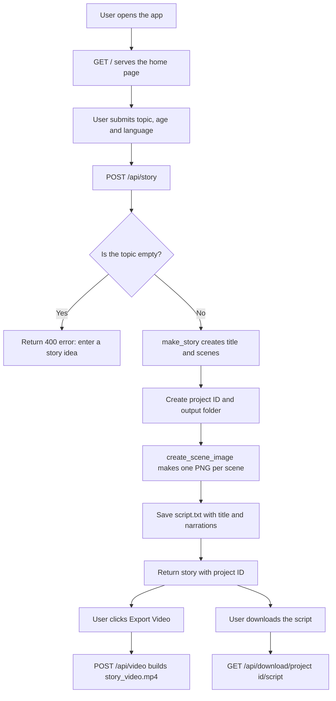
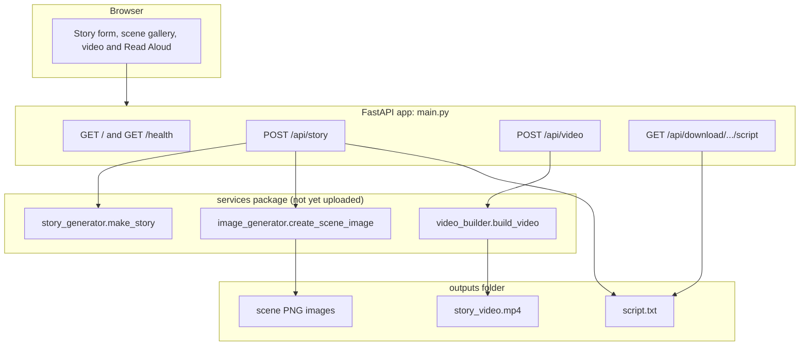

# ToonStory AI 🎨📖

A FastAPI web app that turns a simple story idea into a children's storyboard and a cartoon-style video. You enter a topic, an age group and a language, and the app generates a story, draws an image for every scene, and can export the scenes as a short video.

> 🚧 **Work in progress.** This repository is under active development. This README describes what is already uploaded, and the [Project Status](#project-status) section lists what is still to come.

> 🔱 Forked from [lakshyakansal/toonstory-ai](https://github.com/lakshyakansal/toonstory-ai).

---

## 📋 Table of Contents

1. [What is this Project?](#what-is-this-project)
2. [Project Status](#project-status)
3. [Key Features](#key-features)
4. [How it Works](#how-it-works)
5. [Architecture Overview](#architecture-overview)
6. [API Endpoints](#api-endpoints)
7. [Repository Structure](#repository-structure)
8. [Installation & Running](#installation)
9. [Deployment](#deployment)
10. [Tech Stack](#tech-stack)
11. [Limitations](#limitations)
12. [Roadmap](#roadmap)
13. [License](#license)

---

<a name="what-is-this-project"></a>

## 🎯 What is this Project?

**ToonStory AI** helps create children's stories without any drawing or editing skills. A user types a story idea (for example, "A brave little rabbit"), picks an age range and a language, and the app returns:

- 📖 a story with a title and a series of scenes, each with narration text
- 🖼️ a generated cartoon image for every scene
- 📄 a downloadable story script
- 🎬 an exported video made from the scene images

The backend is built with **FastAPI**, and the front end is served as a **Jinja2** HTML page with static assets.

---

<a name="project-status"></a>

## 🚧 Project Status

| Component | Status |
|---|---|
| FastAPI application (`main.py`) | ✅ Uploaded |
| Dependency list (`requirements.txt`) | ✅ Uploaded |
| Render deployment config (`render.yaml`) | ✅ Uploaded |
| MIT License (`LICENSE`) | ✅ Uploaded |
| Story, image and video services (`services/`) | ⏳ Not yet uploaded |
| HTML templates (`templates/`) | ⏳ Not yet uploaded |
| Static assets (`static/`) | ⏳ Not yet uploaded |

> ⚠️ `main.py` already imports `services.story_generator`, `services.image_generator` and `services.video_builder`, and it expects the `templates/` and `static/` folders. Until those are added, the app cannot be run end to end.

---

<a name="key-features"></a>

## ✨ Key Features

| Feature | Details |
|---|---|
| 📝 **Story Generation** | Creates a titled story with scenes from a topic, age range and language |
| 🌍 **Language Option** | The story language is a request parameter (defaults to English) |
| 👶 **Age Option** | The age range is a request parameter (defaults to 4-8) |
| 🖼️ **Scene Images** | Generates one PNG image per scene and saves it for the project |
| 📄 **Script Download** | Saves the title and scene narrations as a text file you can download |
| 🎬 **Video Export** | Builds an MP4 slideshow from the scene images |
| 🔊 **Read Aloud** | Narration is available through the browser's Read Aloud button |
| 🆔 **Project IDs** | Every story gets a unique project ID and its own output folder |
| ❤️ **Health Check** | A `/health` endpoint for monitoring and deployment checks |
| 🛡️ **Input Safety** | Topic length is limited, empty topics are rejected, and project IDs are checked to block path tricks |

---

<a name="how-it-works"></a>

## 🔄 How it Works

The flowchart below shows what happens from the moment a user opens the app to the final video.



### Step by step

**Step 1: Open the app**

`GET /` serves the `index.html` home page.

**Step 2: Generate a story**

`POST /api/story` takes the topic, age and language. It then:

1. validates the input (an empty topic returns an error)
2. calls `make_story()` to create the title and scenes (narration and visual description)
3. creates a unique project ID and an `outputs/<project_id>/` folder
4. calls `create_scene_image()` for each scene and saves `scene_1.png`, `scene_2.png` and so on
5. saves `script.txt` with the title and scene narrations

**Step 3: Export the video**

`POST /api/video` checks the project ID, finds the scene images and calls `build_video()` to create `story_video.mp4`, a silent slideshow.

**Step 4: Download the script**

`GET /api/download/{project_id}/script` returns the script as `toonstory-script.txt`.

---

<a name="architecture-overview"></a>

## 🏗️ Architecture Overview



---

<a name="api-endpoints"></a>

## 🔌 API Endpoints

| Method | Endpoint | Description |
|---|---|---|
| `GET` | `/` | Serves the home page |
| `GET` | `/health` | Health check |
| `POST` | `/api/story` | Generates a story and scene images |
| `POST` | `/api/video` | Exports the project's scene images as an MP4 |
| `GET` | `/api/download/{project_id}/script` | Downloads the story script as a text file |

### `GET /health`

Response:

```json
{ "status": "ok", "app": "ToonStory AI" }
```

### `POST /api/story`

Request body:

```json
{
  "topic": "A brave little rabbit",
  "age": "4-8",
  "language": "English"
}
```

| Field | Default | Notes |
|---|---|---|
| `topic` | `A brave little rabbit` | Story idea, trimmed to 180 characters |
| `age` | `4-8` | Target age range |
| `language` | `English` | Story language |

Response: the story (a title and scenes, each with narration, visual description and image path), plus `project_id` and `script_file`. An empty topic returns a `400` error.

### `POST /api/video`

Request body:

```json
{ "project_id": "<id returned by /api/story>" }
```

Response:

```json
{
  "video_url": "/outputs/<project_id>/story_video.mp4",
  "message": "Video created. This MVP exports a silent cartoon slideshow."
}
```

The current MVP exports a silent cartoon slideshow, and narration is available through the browser's Read Aloud button.

### `GET /api/download/{project_id}/script`

Returns the story script as a downloadable `toonstory-script.txt` file.

---

<a name="repository-structure"></a>

## 📁 Repository Structure

**Currently in the repository**

```
toonstory-ai/
├── main.py            # FastAPI app: routes, story, video and download logic
├── requirements.txt   # Python dependencies
├── render.yaml        # Render deployment configuration
├── LICENSE            # MIT License
└── README.md          # This file
```

**Coming soon (already used by `main.py`)**

```
toonstory-ai/
├── services/          # story_generator.py, image_generator.py, video_builder.py
├── templates/         # index.html (Jinja2)
└── static/            # CSS, JavaScript and other front-end assets
```

---

<a name="installation"></a>

## 🚀 Installation & Running

**Prerequisites:** Python 3.9+ and `pip`.

> ⚠️ The app needs the `services/`, `templates/` and `static/` folders to run. These will be added as development continues.

**1. Clone the repository**

```bash
git clone https://github.com/kamakshi-13/toonstory-ai.git
cd toonstory-ai
```

**2. (Optional) Create a virtual environment**

```bash
python -m venv venv
source venv/bin/activate
```

On Windows, activate it with `venv\Scripts\activate` instead.

**3. Install dependencies**

```bash
pip install -r requirements.txt
```

**4. Run the app**

```bash
python main.py
```

The server starts on port `8000` by default, or on the port set in the `PORT` environment variable. Open `http://localhost:8000` in your browser, and check `http://localhost:8000/health` to confirm the server is running.

---

<a name="deployment"></a>

## ☁️ Deployment

The repository includes a `render.yaml` for deploying to [Render](https://render.com/):

| Setting | Value |
|---|---|
| Service type | Web service |
| Runtime | Python |
| Plan | Free |
| Build command | `pip install -r requirements.txt` |
| Start command | `uvicorn main:app --host 0.0.0.0 --port $PORT` |
| Health check | `/health` |

---

<a name="tech-stack"></a>

## 🛠️ Tech Stack

| Layer | Technology | Purpose |
|---|---|---|
| Language | Python | Core application logic |
| Web Framework | FastAPI | API routes and app structure |
| Server | Uvicorn | Running the ASGI app |
| Templating | Jinja2 | Rendering the home page |
| Form Handling | python-multipart | Form and request parsing |
| Images | Pillow | Creating scene images |
| Video | imageio-ffmpeg | Building the MP4 video |
| Hosting | Render | Deployment (config included) |

---

<a name="limitations"></a>

## ⚠️ Limitations

- The project is a work in progress, and some modules are not uploaded yet
- Video export is a silent slideshow with no narration track
- Generated files are stored on local disk in the `outputs/` folder
- No user accounts, so anyone with a project ID can access its files

---

<a name="roadmap"></a>

## 🔮 Roadmap

- [ ] Upload the `services/`, `templates/` and `static/` folders
- [ ] Add screenshots of the app to this README
- [ ] Add narration to the exported video
- [ ] Add a description and topics to the GitHub repository

---

<a name="license"></a>

## 📄 License

This project is licensed under the [MIT License](LICENSE).

---

**Author:** Kamakshi Arora and Lakshya Kansal
